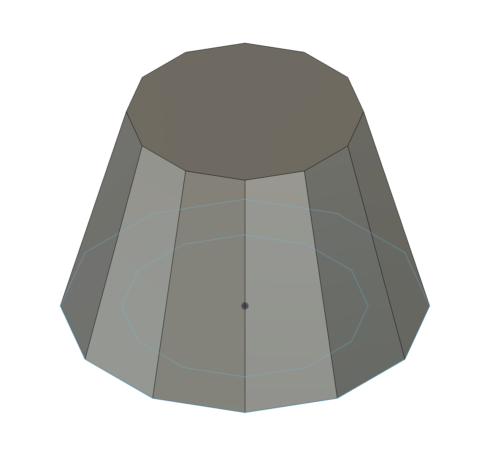
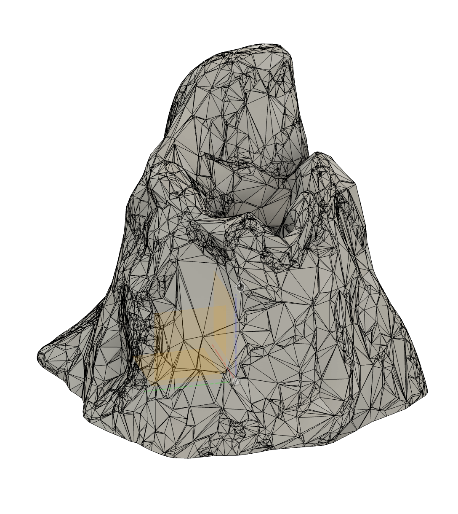
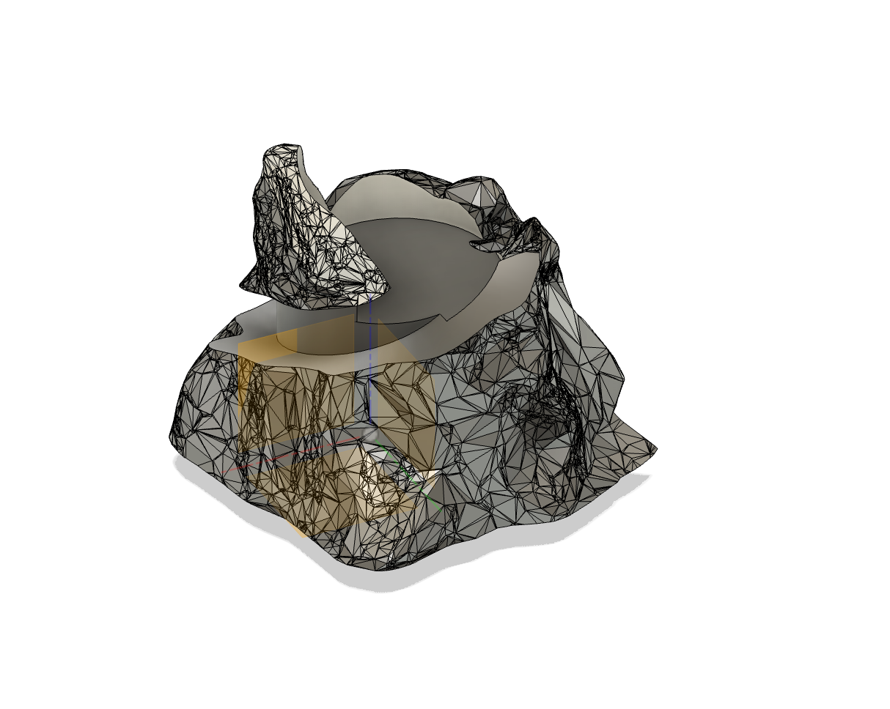
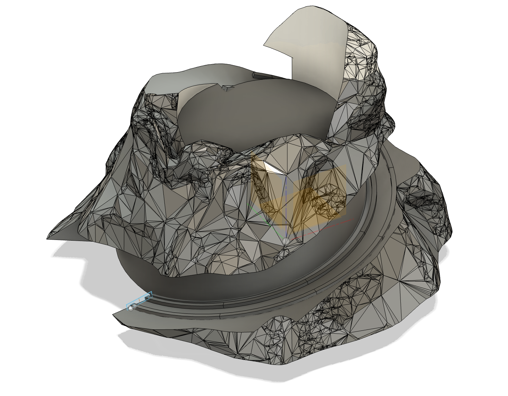
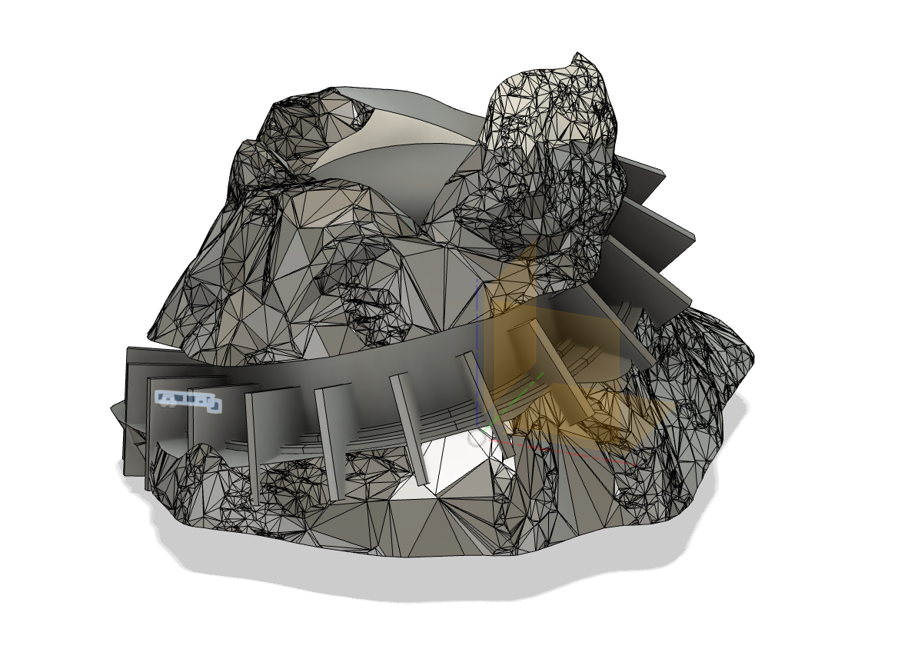
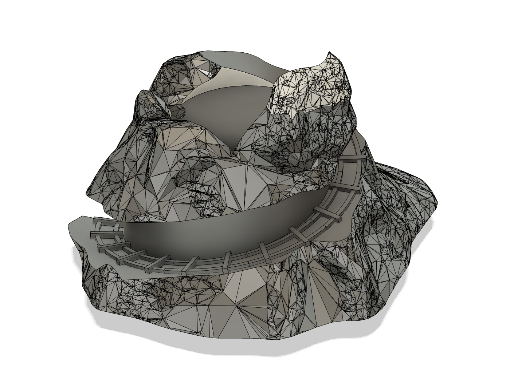
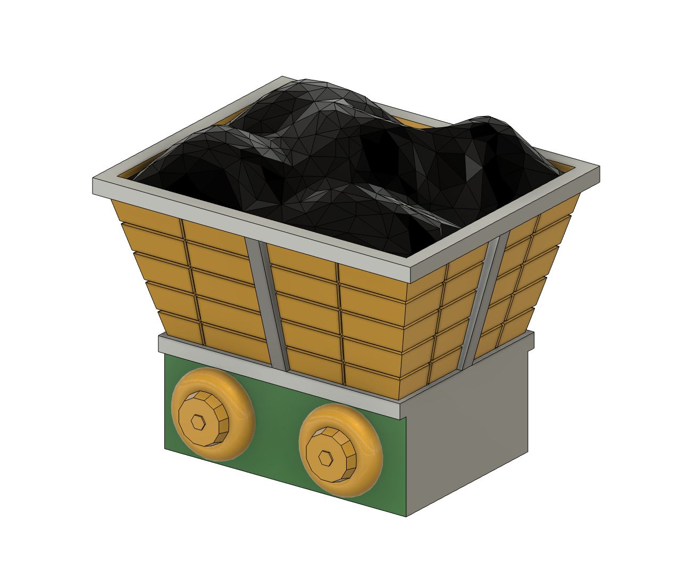

import MinecartViewer from "./MinecartViewer";
import OreTileViewer from "./OreTileViewer";

January at MIT is IAP (Independent Activities Period), a time to try new things. For IAP 2024, [Alayah Hines](https://www.linkedin.com/in/alayah-hines/) and I explored low-temperature metal casting with a custom Settlers of Catan board: design every piece in Fusion 360, 3D print it, make a silicone mold, and cast it in metal.

The metal casting is a story for another time. In the meantime we had access to a few multi-color Bambu X1 Carbon printers, so we printed the board in color.

## Design goals

There were a lot of pieces:
- 5 resource tiles (wood, brick, wheat, sheep and ore) and a desert tile
- Cities, settlements and roads for 4 players
- A robber
- A number of ports
- A frame to hold everything together
- A largest army trophy
- A longest road trophy

With everything in metal, we couldn't tell players apart by color, so each got a theme:

- Player 1: Space Penguins
- Player 2: Rainbow Unicorns
- Player 3: Fire Dragons
- Player 4: Cloud Pigs

Alayah is a CAD wizard and designed most of the cool pieces. Here are a few of mine.

## Ore tile

The ore tile is a mountain with a crater at the top for the number token, and a track around it for a minecart.

### Designing the mountain

I made a rough shape in Fusion 360 and exported it to [SculptGL](https://stephaneginier.com/sculptgl/), an online tool where, unlike dimension-driven Fusion, you pull, press, inflate and smooth the mesh like clay.

*Mountain base*

*Textured mountain base*

I rescaled it to fit the board and cut out the crater and a path for the minecart.

*Mountain with crater and path*

The tracks were the trickiest part. I used the **Pipe** tool to run a pipe around the path, then sketched the two rails and **swept** them along it.

*Tracks swept along path*

For the bars between the rails, I extruded one from the track sketch, offset its faces and patterned it along the path. The bar rotates with the path, so the offset keeps part of it perpendicular to the track.

*Bars patterned around the tracks*

To trim them, I swept the original track sketch along the path and intersected it with the bars.

*Mountain with track bars*

### Designing the minecart

Nothing fancy: I sketched the parts and extruded them. For the gems, I lofted between different polygons, converted the body to a mesh, then remeshed and reduced the faces for a more gem-like shape.

<MinecartViewer client:only="react" />

I reused the cart for one full of coal.

*Minecart with coal*

### Bringing it together

I combined the mountain and minecart and added some gems to the mountainside.

<OreTileViewer client:only="react" />
