I designed the board in spirals. First I implemented everything in Prof. Neil Gershenfeld's HTMAA example [schematic](http://academy.cba.mit.edu/classes/embedded_programming/index.html) for a SAMD21E board, then added the extras.

## Breaking out the pins

I wanted to break out all the pins for future breakout boards. I used horizontal pins instead of vertical ones for ergonomics when the board is placed in a pocket. I broke out every unused pin on the SAMD21E except four:
- **PA00** and **PA01** are oscillator pins meant for a crystal. The SAMD21E includes multiple internal RC oscillators so doesn't require an external crystal.
- **PA27** and **PA28** were kept for on-board status LEDs

I broke out ground, 5V and 3.3V pins in various places also.

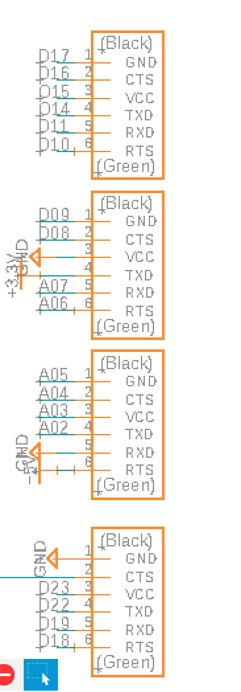
*Header schematic*

## Adding a reset button

While developing firmware things often go wrong, you end up in weird states, or you just need to start over. Most boards include a reset button for this, and I wanted one too.

The microcontroller restarts whenever the reset pin is brought to ground. The pin is already used by the JTAG, so I connected my extra components to the same net. The pin has a 100ohm pull-up resistor to 3.3V, and a button shorts the line to ground when pressed.

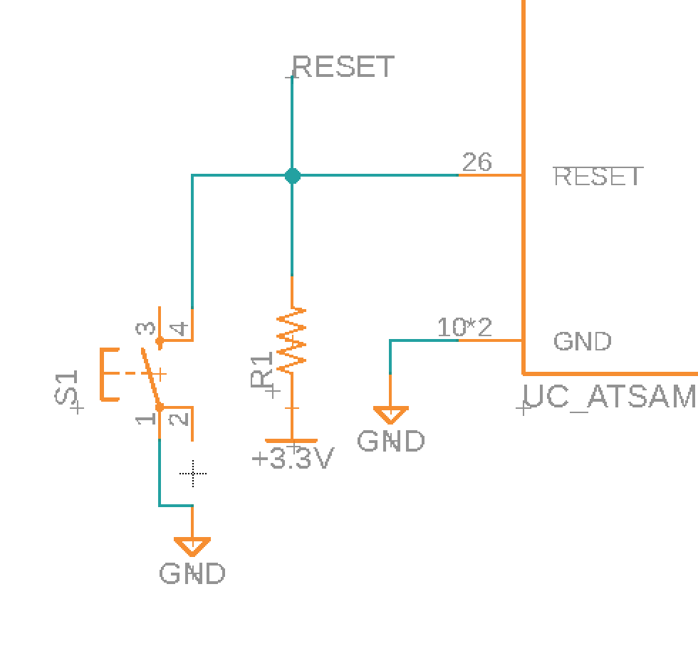
*Button schematic*

## Power and status LEDs

I wanted one LED that's always on when the board has power, plus two more for debugging and status. The power LED is wired directly to 3.3V and ground.

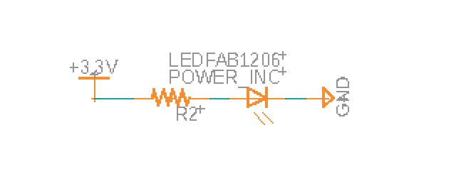
*Power LED schematic*

For the status LEDs, I wired resistors and LEDs to **PA27** and **PA28**.

## Micro USB

I included a micro usb port to program the board over

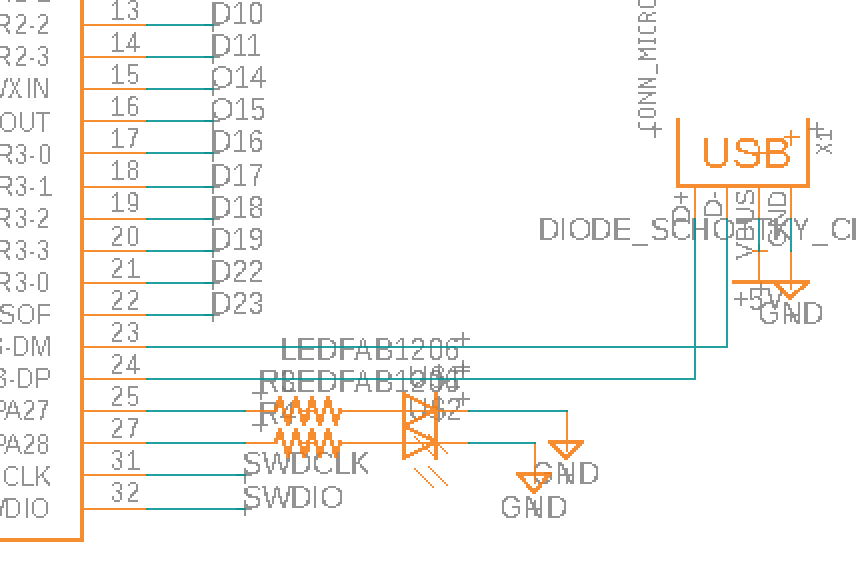
*Micro USB schematic*

## Barrel jack connector

Finally I wanted to a barrel jack connector to power the board in the various places it might end up. I included a 5V regulator to step down up to 12V which could be supplied.

The barrel jack has a switch. When on, it sends the regulator's 5V to the board and the GPIO pins. When off, 5V only goes to the GPIO pins.

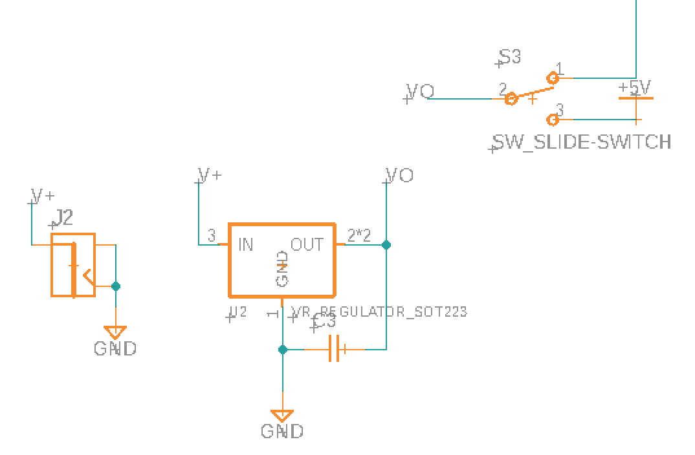
*Barrel jack schematic*

## Schematic for the dev board

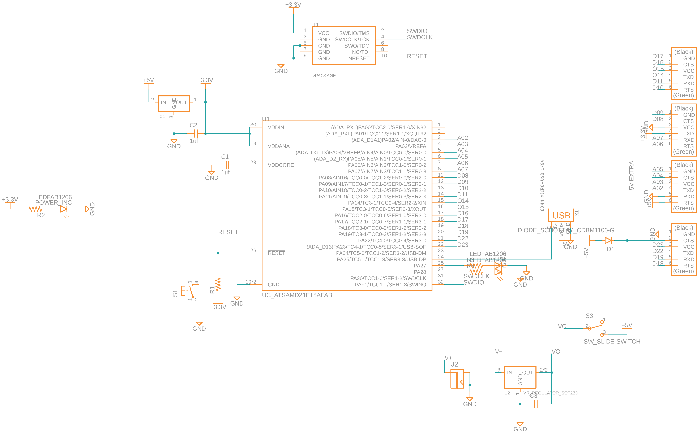
*Schematic for the dev board*

## Routing the board

Since this board was going to be milled, I wanted to route this as a single-layer board. Using a second layer would require vias which on a milled board usually necesitates hammering rivets in (as copper electroplating is diffcult / toxic).

I started by placing the SAMD21E in the centre and connecting it to the headers. Then I placed and routed everything else. In the end I needed no vias or 0 ohm resistors. The trick was running a ground trace along the far side of the FTDI header pads and routing underneath the SAMD21E and the button.

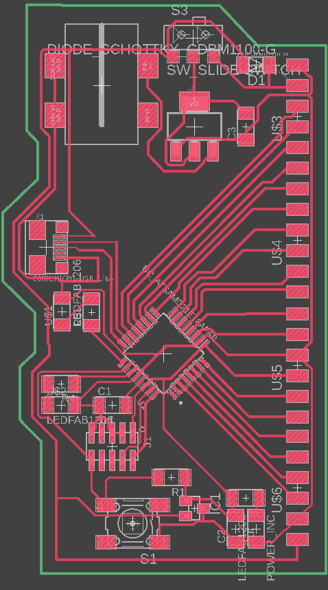
*Routed dev board*

# Adding a little flair

The only thing left was a bit of flair.

In my freshman year, the number 1213 came up while I was writing equations on a whiteboard. My handwriting is atrocious, so the digits mashed together into something that looked like RBT, which conveniently are my initials. Ever since, I've put 1213t on things I make.

*My initials*

Eagle at time had poor support for image, so I followed a [SparkFun guide](https://learn.sparkfun.com/tutorials/importing-custom-images-into-eagle), which has you install a ULP script for SVGs. On a Mac, you can find the ULP folder under **your profile (top right)** > **Preferences** > **Electronics** > **Directory** > **Directory for ULP**.

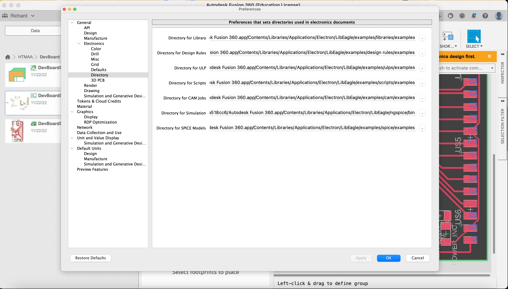
*ULP directory in Eagle settings*

I ran the svg2poly script, picked my file and clicked **Ok**.

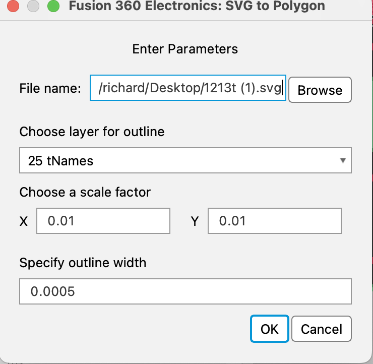
*svg2poly prompt*

Nothing appeared 😥, whatever scale I tried. Next I tried a bitmap: I exported the SVG from Illustrator and imported it with **run import-bmp**. RGB had too many colours, and greyscale showed off how old Eagle is by opening a colour dialog so large I couldn't reach the ok or cancel buttons.

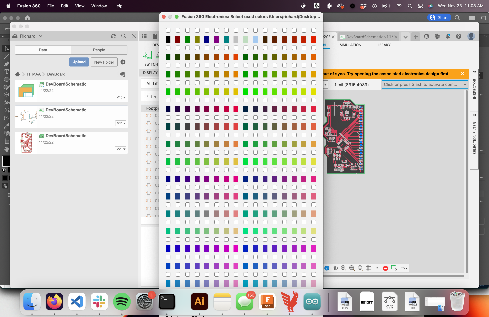
*Colour dialog too large for the screen*

Only black-and-white bitmap mode worked, and the result was literally made of individual coloured squares. The warning I'd skimmed said as much: the feature is meant for tracing over with the polygon tool, not for keeping.

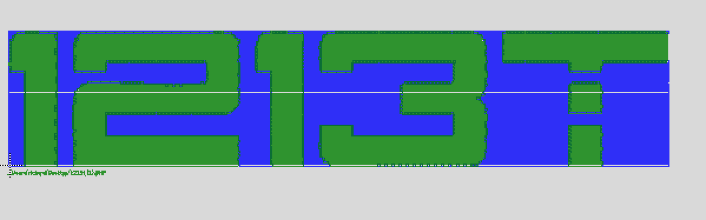
*1213t imported as a bitmap*

The last option was DXF. I re-exported from Illustrator and ran **run import-dxf**. The first attempt showed nothing, but after fiddling with the scale something finally appeared.

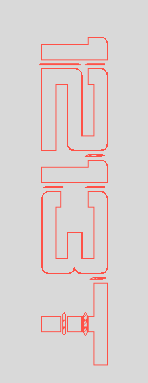
*1213t imported as a DXF*

With my clearance settings the traces were too close together, and Eagle wouldn't let me move them directly. I had to deform each letter to satisfy the rules, move it individually and reassemble everything, then fill the letters with **Polygon** > **Polygon Pour from Outline**. It looked pretty awful, and worse in the Othermill.

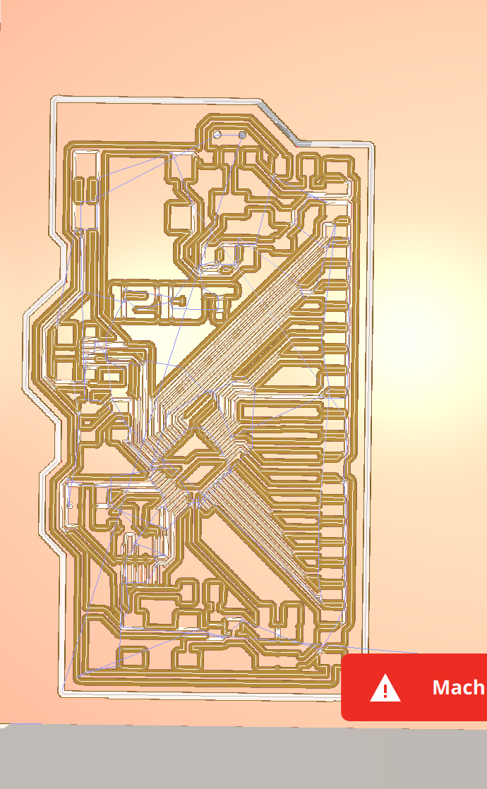
*Awful CAM plan for 1213t in the Othermill*

It no longer looked like my signature. Two hours in and pretty frustrated, I finally did what I should have done at the start and googled it. **The Othermill can engrave SVGs directly.**

# Milling the board

For milling boards I had previously been using 1/64” endmills, however these cost around $18 apiece and break easily. Instead, engraving bits can be used which cost ~$1. They're also faster: switching from the 1/64” FEM to a 0.005” engraving bit cut my milling time from 39 to 25 minutes.

However, as engraving bits have a "V" shape at their end it's very important to know the exact height of the copper blank (including the tape underneath). If this is wrong you'll go further up the V causing a wider region to be removed which will wreck tight traces.

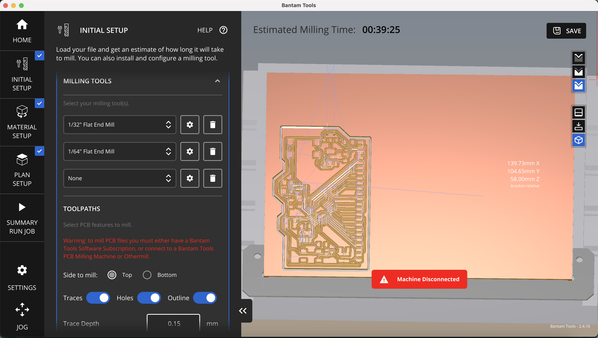
*Othermill job time using a 1/64 endmill*

*Othermill job time using a 0.005 engraving bit*

I followed a [guide](https://support.bantamtools.com/hc/en-us/articles/115001656913-Engraving-Bit-Isolation-Milling) from Bantam Tools (what Othermill rebranded to) on setting up the engraving bit. I laid the double-sided tape carefully so none of it overlapped, since that would cause a height difference. Then I measured the material and tape with digital callipers and entered it under **thickness**.

I added the svg file of my initials in Bantam Tools also. I set the tool to the **0.005” PCB engraving bit**. Then in the **Plan setup** tab I positioned the text where I wanted it engraved.

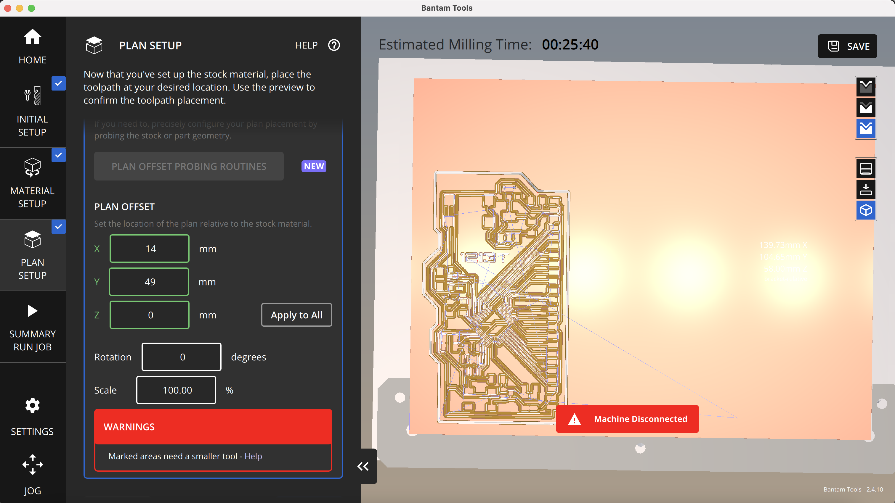
*Othermill job*

The milling job ran and everything worked great.

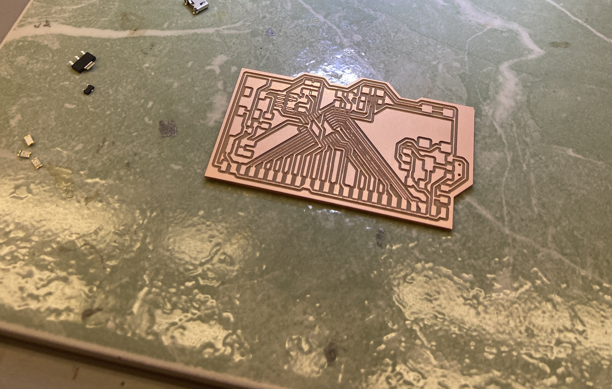
*Milled board*

## Soldering

The SAMD21E is a pretty small chip, so I soldered it with solder paste and a hot air gun, then did the rest of the components by hand.
