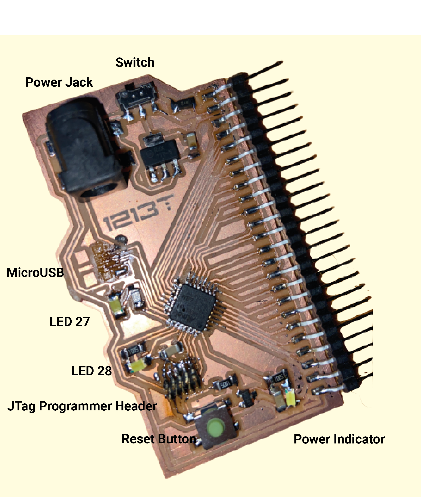

I always wanted to make my own version of the Arduino Uno. In 2022 I learned to design PCBs in Eagle and mill them on an Othermill. To bring this all together, I created my own devboard around the SAMD21E microcontroller - with a micro USB, barrel jack, reset button and status LEDs.

*Labelled dev board*

