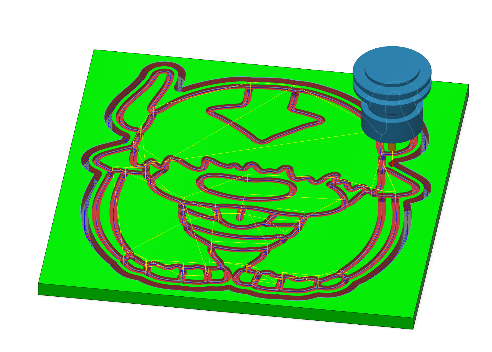
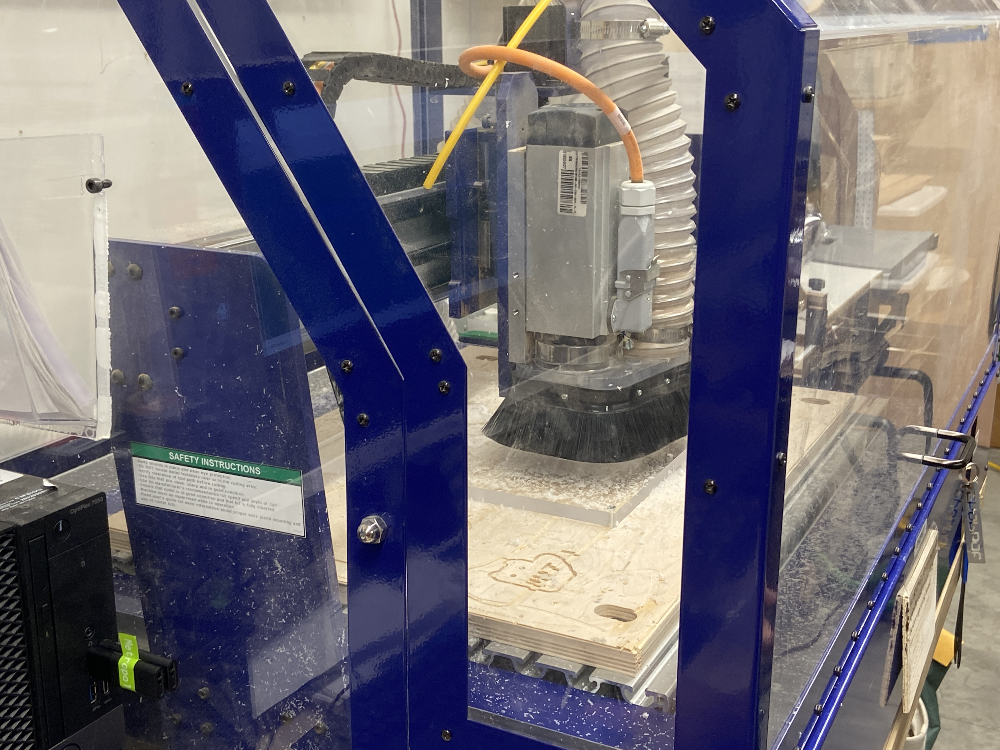
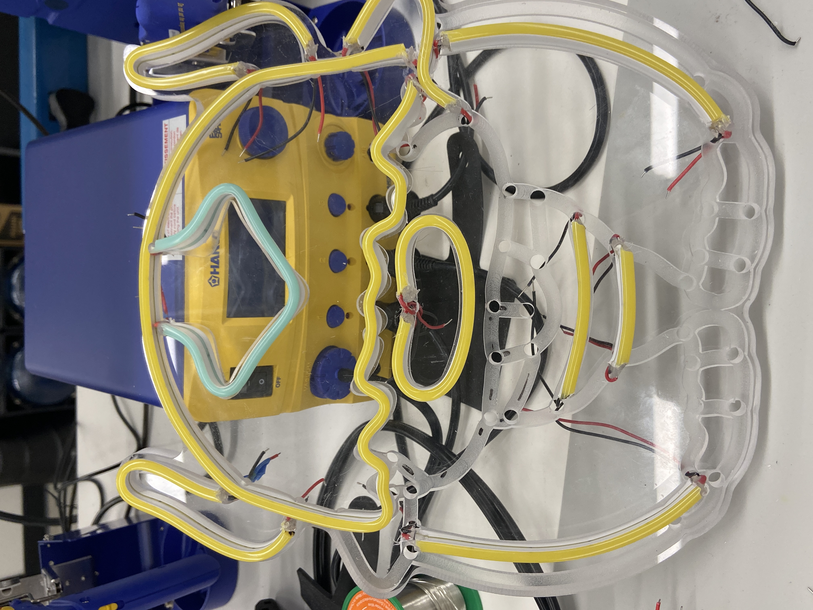
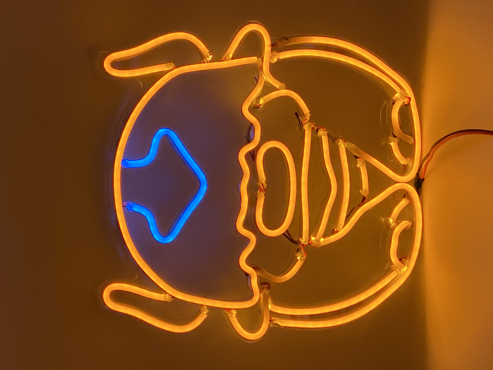

## Designing the sign

I began with an image of Appa and then used Adobe Illustrator to convert it into a vector drawing. The LED strips we used come in 1 inch increments so I modified the line lengths to match this constraint.

Finally, I offset the outside of the image to make the outline for the sign.

## Setting up the CAM

I used Fusion 360 to setup the CAM program, using a 1/8" endmill to cut the sign from a 1/4" sheet of acrylic.

*Simulated CAM job in Fusion 360*

## Cutting the sign

I cut the sign on the ShopBot CNC router.

*Sign being cut on the CNC router*

## Wiring the sign

This was the hardest part. I cut the LED strips to fit the different channels, soldered them together, and wrapped the exposed wires in heat shrink to prevent shorts. I used hotglue as mechanical strain relief for the solder joints.

*Adding the wires to the channels*

Finally, I connected the sign to a 12V power supply and it lit up!

*Appa LED neon sign*