import Connect4RobotViewer from "./Connect4RobotViewer";

In Spring 2024 I took 6.115 (Microcomputer Project Laboratory) at MIT, a deep dive into embedded systems. Over four labs we built circuits and wrote code to:

- Find the resonant frequency of a fluorescent light and strike it
- Display a laser light show
- Control a robot arm
- Reconstruct a 3D object from 2D images

All of it ran on an 8-bit [Intel 8051](https://en.wikipedia.org/wiki/MCS-51) microcontroller, programmed in assembly.

The last month of the class was a final project. The only criterion was that it had to use the [Cypress PSoC 5LP](https://www.infineon.com/cms/en/product/microcontroller/32-bit-psoc-arm-cortex-microcontroller/32-bit-psoc-5-lp-arm-cortex-m3/). I built a robot that plays Connect 4 on a physical board, because:

- I love building things that interact with the physical world
- I wanted to explore the algorithms behind game-playing AI
- **Most importantly**, I suck at Connect 4 and wanted a robot that could beat my friends for me

Here it is in action:

<iframe class="m-auto pb-4 max-w-full" width="560" height="315" src="https://www.youtube.com/embed/X0XXUfkOlMY?si=PBQl1yqKR_Zg6yaH" title="YouTube video player" frameborder="0" allow="accelerometer; autoplay; clipboard-write; encrypted-media; gyroscope; picture-in-picture; web-share" referrerpolicy="strict-origin-when-cross-origin" allowfullscreen></iframe>
<iframe class="m-auto pb-4 max-w-full" width="560" height="315" src="https://www.youtube.com/embed/JORZFqTXGA4?si=DMwjJiMhEpfSM4cQ" title="YouTube video player" frameborder="0" allow="accelerometer; autoplay; clipboard-write; encrypted-media; gyroscope; picture-in-picture; web-share" referrerpolicy="strict-origin-when-cross-origin" allowfullscreen></iframe>

## Design goals

- **Play Connect 4** on a physical board
- **Simple mechanical design** that's easy to build and maintain
- **Fast** enough to play a game in a reasonable amount of time

## Mechanical design

Actuation was the part I was least sure about. I considered:

1. Seven hoppers, one above each column. This would need seven servos, which felt excessive.
2. One hopper on a timing belt, positioned by a stepper. But then I'd have to home it and keep track of its position.

I settled on a fixed hopper plus a servo-mounted plane that covers every column up to the one I want to drop a piece into.

I modeled the robot in Fusion 360, with the thickness of every extruded piece parametric so I could adjust it before laser cutting, and finger joints for easy assembly.

<Connect4RobotViewer client:only="react" />

### The gotchas

It took five iterations to get the design right. The main issues:

1. **Acrylic vs plywood:** Acrylic was too brittle and cracked when I tried to attach the pieces, so I switched to plywood, which was much easier to work with.
2. **Getting pieces to land in the right place:** I tuned the angle of the plane so pieces would roll, but not so fast that they overshot their column. I also added a lip after each hole in the plane to stop them rolling further.
3. **Pieces getting stuck on the plane:** I added tape to the front and back of the plane to reduce friction, and made the plane itself out of acrylic so it was more slippery.

## Electrical design

### Detecting game pieces

Seven [RPR-220](https://www.digikey.com/en/products/detail/rohm-semiconductor/RPR-220/638554) reflective photosensors, one at the top of each column, detect when a piece falls in. Each is a single package with an LED and a phototransistor. I used copper tape to connect both ground legs and wired the signal legs to the PSoC.

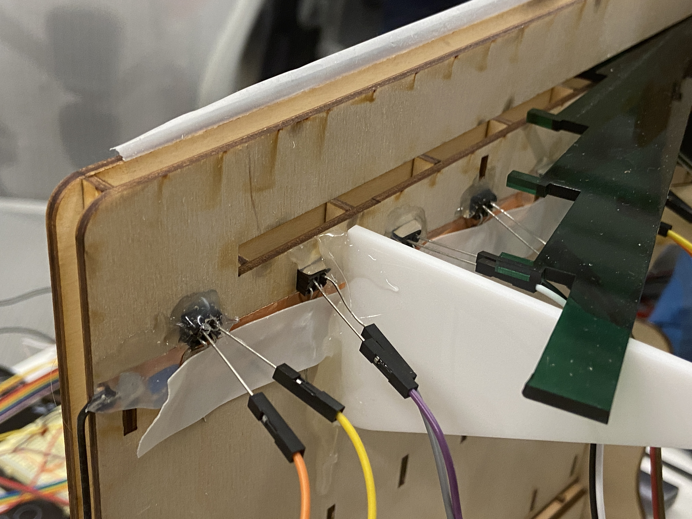
*Photointerrupters on the back of the robot, wired with copper tape*

The phototransistor current varies with how much light is reflected back. The datasheet specifies 100% current at 6mm, dropping off when a piece falls in front. So I used a pull-up resistor: when a piece passes, the current drops and the voltage goes high. With red and yellow pieces the current never reached 0%, so I adjusted the resistor until the PSoC read a high voltage (around 1.25V) with a piece in front of the sensor.

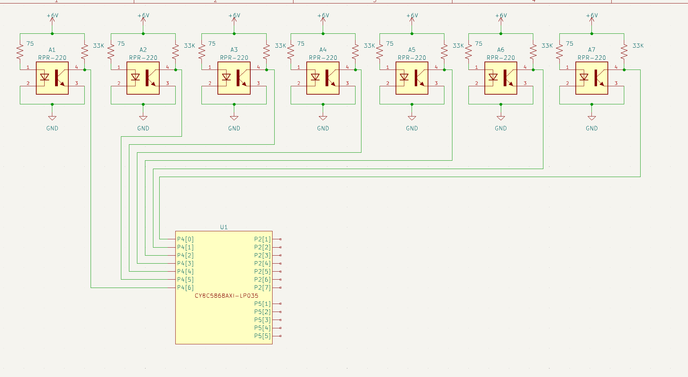
*Photointerrupter and PSoC 5LP schematic*

### Displaying the game board

I used a [HiLetgo ILI9341 TFT Screen](https://www.amazon.com/dp/B073R7BH1B?psc=1&ref=ppx_yo2ov_dt_b_product_details), a 2.8" touchscreen with an SD card reader. The PSoC supports the emWin library, which makes drawing shapes and text relatively easy.

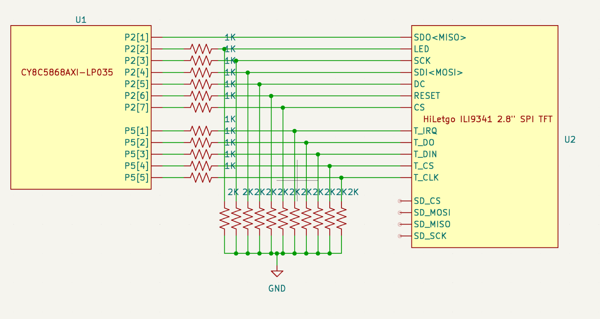
*TFT screen schematic*

### Playing sound effects

An 8-ohm speaker driven by an LM386 amplifier plays sound effects. I only wanted to play tones, so I didn't need any filters.

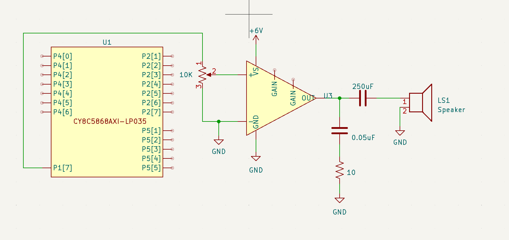
*Speaker schematic*

### Actuating the robot

Two servos: one moves the plane, the other drops the pieces.

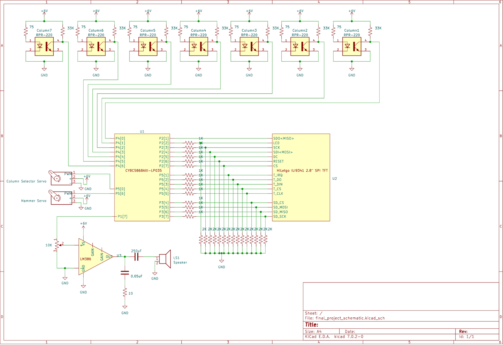
*Full robot schematic*

## Software design

All the code is in C and split into modules to make debugging and testing easier. The full code is on [GitHub](https://github.com/r-bt/Connect4-PSOC).

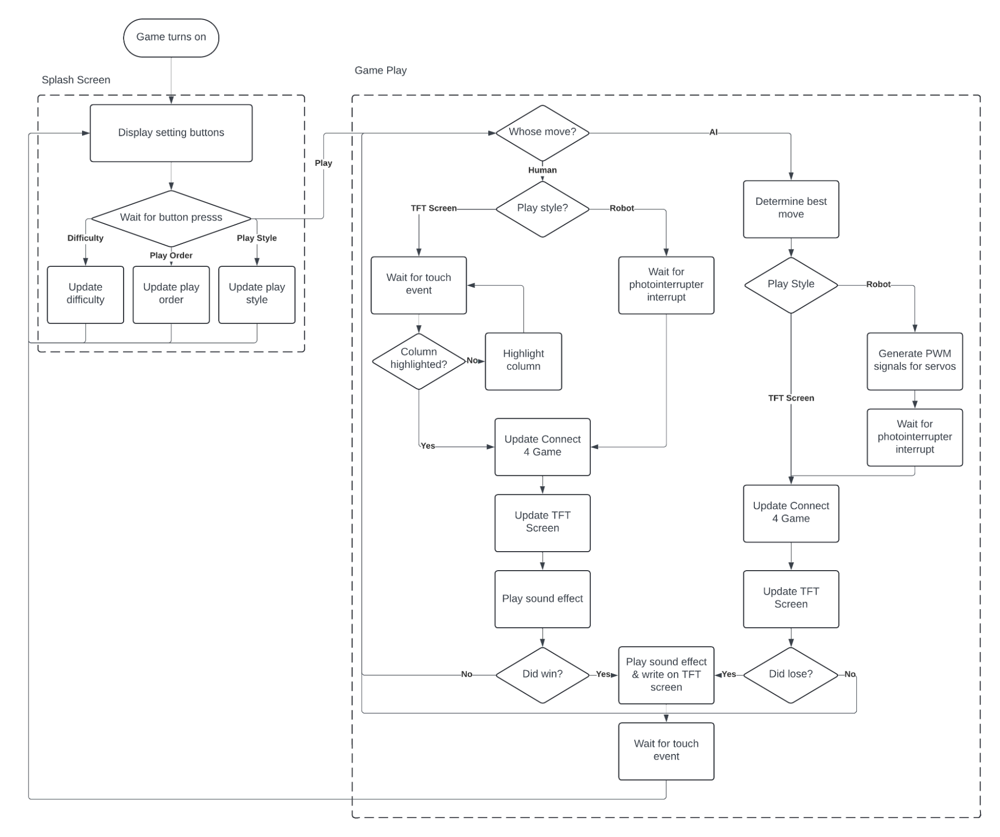
*Software flowchart*

### TFT screen

I used emWin to draw the board and pieces, plus a settings screen where you choose the difficulty, who goes first, and whether to play on the robot or the screen.

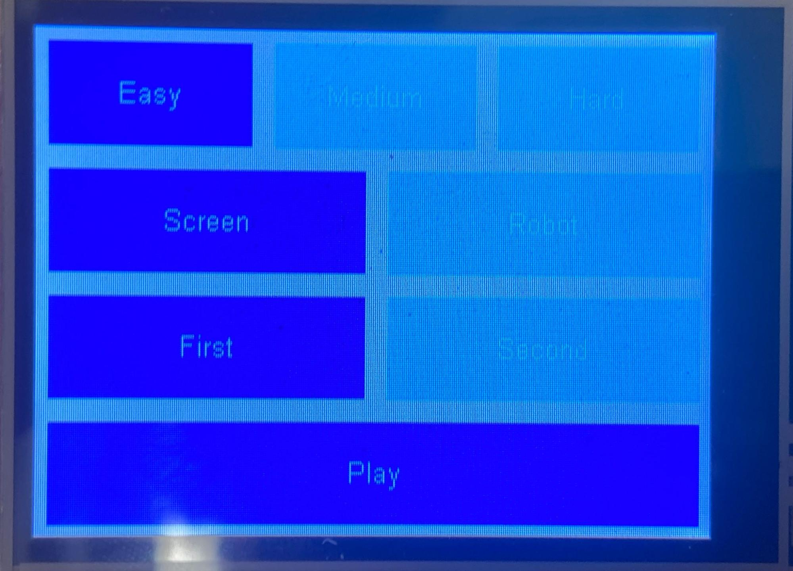
*Settings screen*

In screen play you tap a column on the touchscreen to drop a piece. In both modes the robot taunts you, using taunts read from a text file on the SD card with the emFile library.

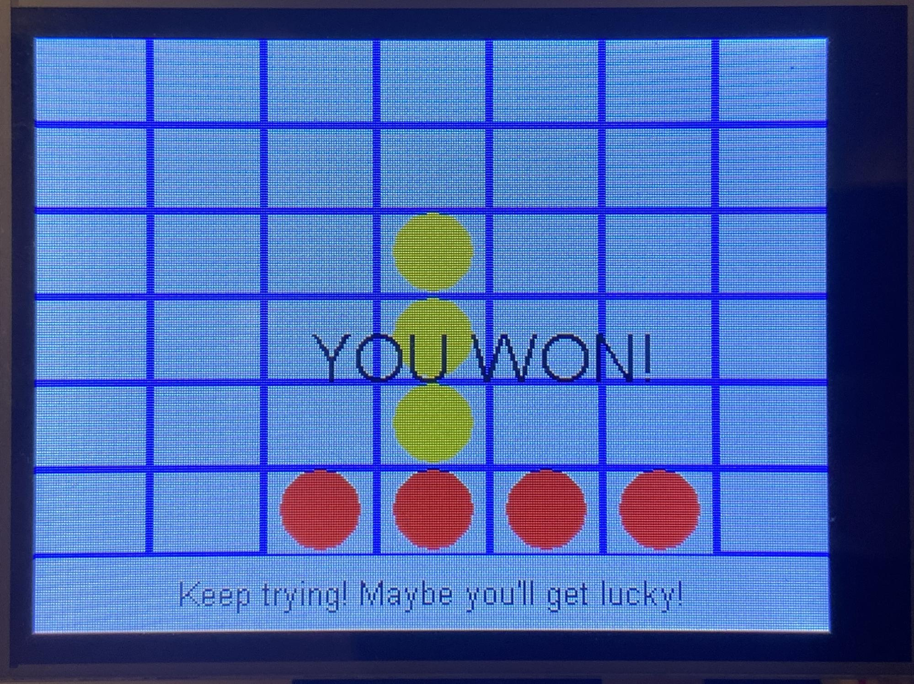
*A game of Connect 4 on the TFT screen*

### Game and AI

I represented the board as a [bitboard](https://github.com/denkspuren/BitboardC4/blob/master/BitboardDesign.md): one 64-bit number per player, where a 1 is their piece and a 0 is an empty space or the other player's piece. This makes checking for wins fast with bitwise operations.

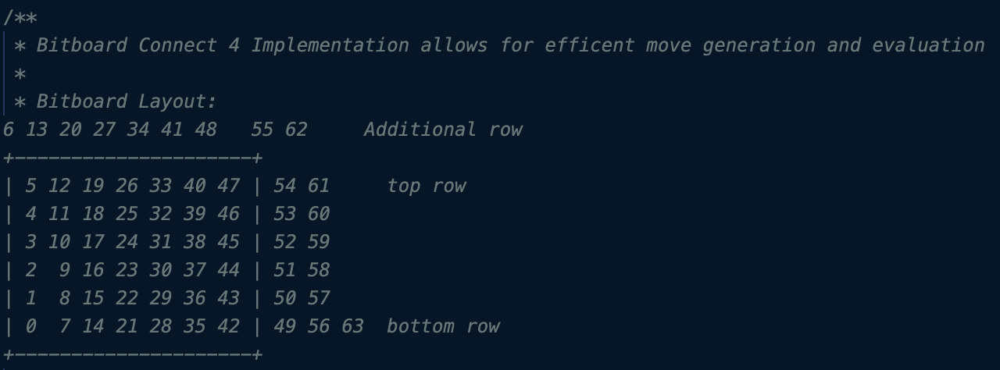
*Connect 4 bitboard representation*

The AI uses [minimax](https://en.wikipedia.org/wiki/Minimax). A **heuristic** function scores a board state; the AI simulates every possible move up to a certain depth and picks the move that maximizes the heuristic for itself and minimizes it for the player. There are three difficulty levels:

1. **Easy**: looks one move ahead
2. **Medium**: looks five moves ahead
3. **Hard**: looks 10 moves ahead

At 10 moves the AI would need to evaluate 7^10 = 282,475,249 moves, which was too slow. Two optimizations helped:

1. **Negamax**: Connect 4 is zero-sum, so the AI's score is the negative of the human's. That means I only need to implement the max half of minimax.
2. **Alpha-beta pruning**: I track alpha (the best guaranteed score for the maximizer) and beta (the best guaranteed score for the minimizer), and prune any node below alpha or above beta.

For the heuristic, each position has a value (the bottom of the center column is the best spot, for example). A player's score is the sum of their pieces' values, plus bonus points for three-in-a-row.

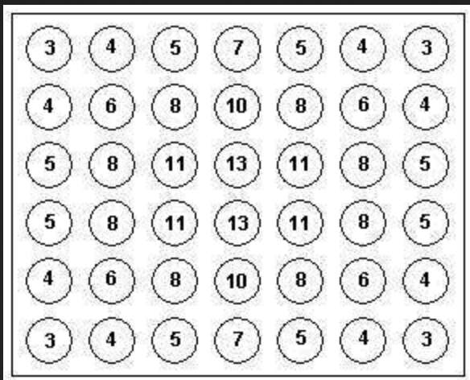
*Values given to Connect 4 positions*

### Controlling the robot

The photointerrupters trigger an interrupt when a piece falls. I had to debounce it, since the controller was fast enough to detect the same piece several times as it fell.

I found the right PWM values for moving the plane and dropping pieces by hand, accounting for the slight wiggle in the servo.

Occasionally a piece lands in the wrong column. The robot always detects where its piece actually fell and rolls with it. It isn't a real fix, but the randomness makes the game more fun, since you can occasionally win.

## PSoC hardware

One of the PSoC's big draws is its programmable hardware: blocks you instantiate and wire together to make DACs, ADCs, PWMs and more. I used:

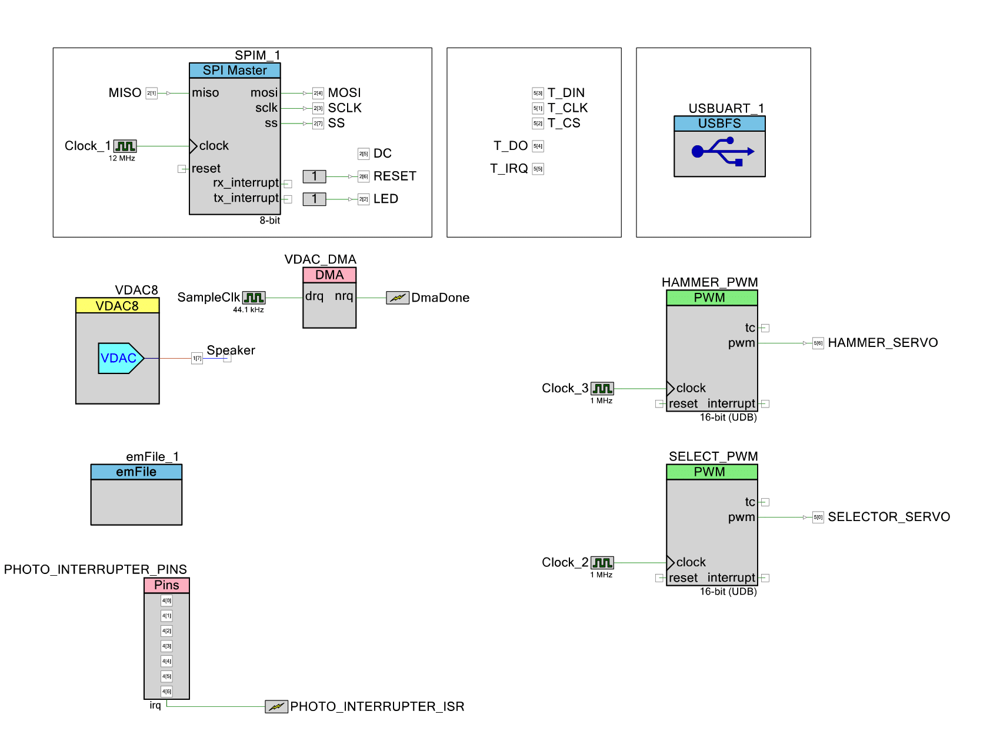
*PSoC hardware blocks*

1. **SPI**: to talk to the TFT screen
2. **Digital pins**: to talk to the touchscreen module
3. **PWM**: to control the servos
4. **USBUART**: to send debug information to my computer
5. **emFile**: to read files from the SD card
6. **Digital pins + interrupt**: to read the photointerrupters
7. **VDAC and DMA**: to play sound effects

## Takeaways

I learned a lot about embedded systems, game-playing AI and mechanical design. I also played a lot of Connect 4, though I can't say I got any better at it. This is only a high-level overview, so if you want more detail, reach out or look through the code.
