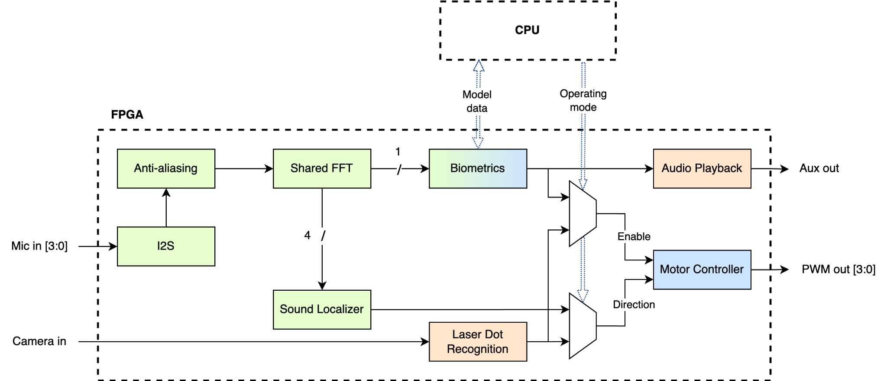
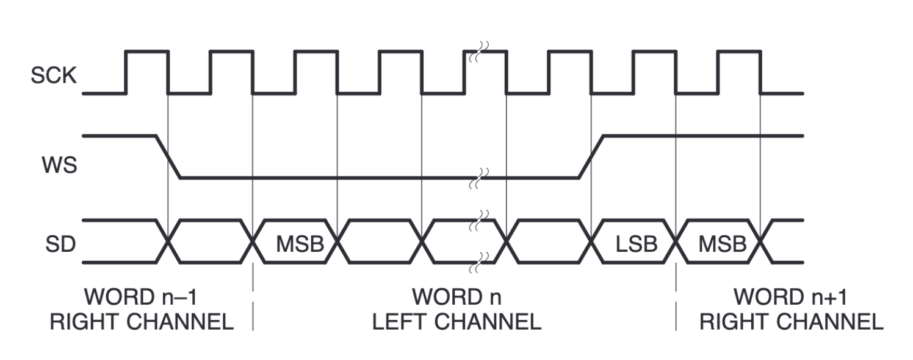
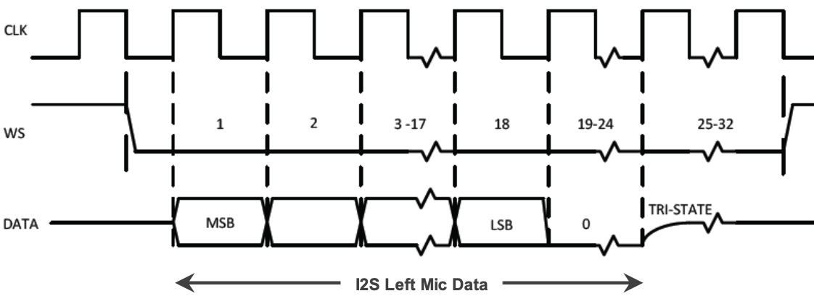
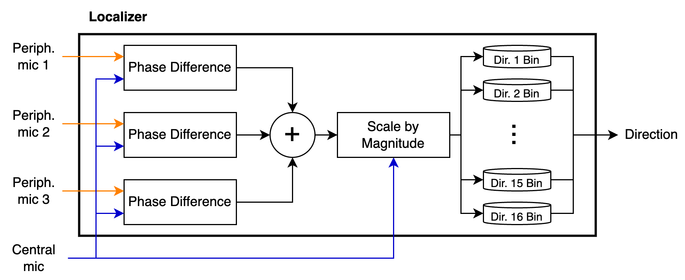
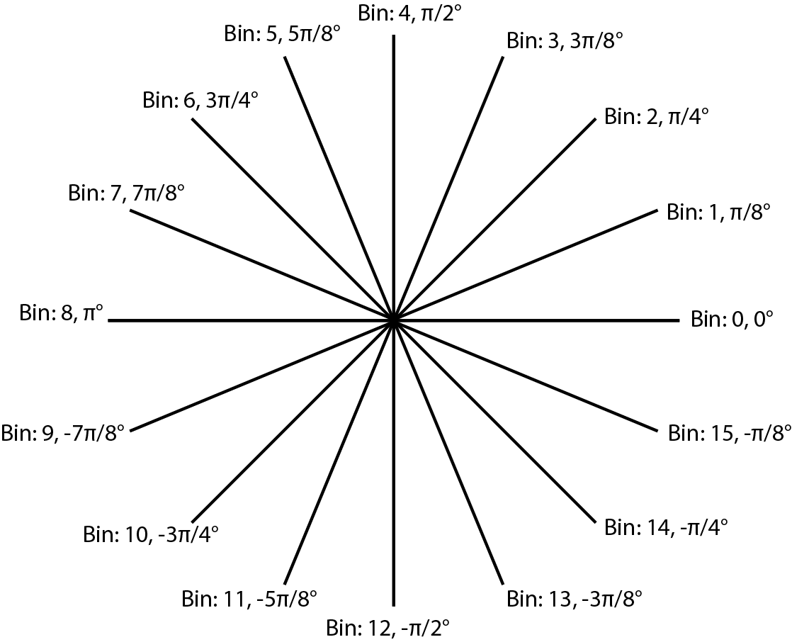

import LocalizationDemo from "./LocalizationDemo";

In Fall 2023 I took [6.2050](https://fpga.mit.edu/6205/F23) (Digital Systems Laboratory), which covers digital logic, FPGAs, SystemVerilog, communication protocols and more. Weekly assignments included:

- Implementing an SPI transmitter and receiver
- Drawing shapes over HDMI
- Decoding audio

A large part of the class was a final project, which I did with [Andi Qu](https://mitadmissions.org/blogs/entry/6-2050-field-programmable-gate-awesomeness/). At the start, [Joe Steinmeyer](https://www.jodalyst.com/), the lecturer, showed some previous projects, all of which set the bar high:

- [Using stepper motors to play songs](https://fpga.mit.edu/videos/2022/team28/video.mp4)
- [An internet-controlled laser projector](https://fpga.mit.edu/videos/2020/team10/video.mp4)
- [A robot that plays air hockey](https://fpga.mit.edu/videos/2018/team01/video.mp4)

We decided to focus on what FPGAs do better than regular computers: **real-time processing**. So we built a robot that recognizes its owner's voice, localizes them in a room, and moves towards them. Effectively a robotic cat, or **Feline Programmable Gate Array**.

Here's the final result. The demo video isn't the best, but you can see (especially towards the end) the robot moving towards me.

<iframe class="m-auto pb-4 max-w-full" width="560" height="315" src="https://www.youtube.com/embed/ZVBrdW6CN-c?si=RewYE4DpcvThKodU" title="YouTube video player" frameborder="0" allow="accelerometer; autoplay; clipboard-write; encrypted-media; gyroscope; picture-in-picture; web-share" referrerpolicy="strict-origin-when-cross-origin" allowfullscreen></iframe>

## Design goals

We split the project into sub-goals:

- I2S audio input (Richard)
- MFCC feature extraction (Andi)
- Bluetooth communication (Andi)
- Real-time SVM inference (Andi)
- Motor control (Richard)
- Real-time audio localization (Richard)

*System overview*

Below are my parts. For the full details, read our [report](/6_2050_Final_Report.pdf) or see the [code](https://github.com/dolphingarlic/feline-programmable-gate-array).

## Audio input

We used [SPH0645LM4H-B](https://www.adafruit.com/product/3421) I2S MEMS microphones on Adafruit breakout boards. Localization needed four of them on a breadboard: three arranged in a triangle around one central microphone. The idea is that the sound reaches each microphone with a different phase. We placed them on a 3 cm grid: speech tops out around 3 kHz, where the wavelength is 11.44 cm, and keeping every microphone within half a wavelength (5.72 cm) of the centre means the phase difference can't wrap past ±180° and point the wrong way (spatial aliasing).

<LocalizationDemo client:only="react" />

The microphones send audio over I2S. In standard I2S, data is written on the _falling edge_ of the serial clock (SCK):

*Standard I2S: data changes on the falling edge of the clock*

The SPH0645LM4H-B, however, writes data on the _rising edge_:

*SPH0645LM4H-B: data changes on the rising edge of the clock*

So I wrote a custom I2S controller, which generates the serial clock (SCK) and word select (WS) signals, and a receiver that reads the data from the microphones.

I spent about three weeks trying to get these microphones working. Even after hours with the TAs and Joe, I couldn't figure out why the audio was so quiet. Then one day, looking at the data on an oscilloscope, I noticed the six most significant bits were always 1. Left-shifting the audio by six bits made it much louder and easier to work with.

### Filtering and decimating

Human speech typically sits between 20 Hz and 3 kHz, but we sampled at 32 kHz, so I passed the audio through a low-pass finite impulse response (FIR) filter. I used the Xilinx FIR Compiler IP, which also supports decimation, to bring the sample rate down to 8 kHz.

### Phase and amplitude

Both localization and voice biometrics needed the phase and amplitude of the signal. I used the Xilinx FFT LogiCORE™ IP with four channels (one per microphone) on 512 samples, which we found experimentally balanced resource usage and accuracy.

## Sound localization

The phase difference between microphones tells you the direction of the sound source.

I took the 512 FFT coefficients and discarded the upper 256, since by the Nyquist–Shannon sampling theorem only the lower 256 are usable. Then I converted them from rectangular to polar form. For each frequency I:

1. Calculated the phase difference between the central microphone and each of the others
2. Scaled each peripheral microphone by the phase difference and the amplitude at the central microphone
3. Summed the scaled locations
4. Assigned the resulting direction vector to one of 16 bins

*Structure of the localization module*

Once all 256 frequencies are processed, the bin with the greatest magnitude gives the direction of the sound source.

*The 16 angle bins*

## Motor control

### Servo motor control

To test localization, I generated PWM signals to drive a servo, mapping each bin to a different duty cycle so the servo pointed at that angle.

### DC motor control

I first tried continuous servos to move the robot, but they made enough noise to interfere with localization. Instead we used two Adafruit DC Gearbox TT Motors. These have three inputs: IN1, IN2 and EN. IN1 and IN2 set the direction, and since the motors only ever turned clockwise, they were always low and high respectively. EN enables the motor, so I drove it with a PWM signal to vary the speed. I chose 20 kHz so it wouldn't interfere with localization or voice biometrics.
