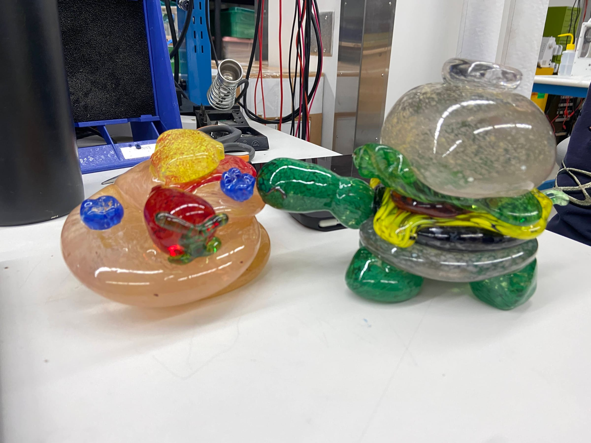

import Gallery from "../../../components/Gallery.astro";

I'm lucky to be part of the MIT glassblowing lab, where I get to make all sorts of cool things **out of glass!** I've taken the beginner class twice (Fall 2022 and Fall 2023) and the intermediate class once (Spring 2024).

The last week of the beginner class is always a project week where you can make anything you want. I made a turtle.

*The turtle, back in the lab*

## Other glass pieces

Here are some of my favorite other things from the glass lab. Click any photo to see it larger.

### Goblets

<Gallery
  dir="glass-blown-turtle/gallery"
  items={[
    ["twisted-stem-goblet", "A small goblet with a twisted stem"],
    ["tall-goblet", "A tall, narrow goblet"],
    ["swirl-goblet", "A goblet with a swirled bowl"],
    ["tilted-goblet", "A goblet with a tilted rim"],
    ["rose-goblet", "A goblet with a rose on the stem"],
    ["yellow-flower-goblet", "A goblet with a yellow flower on the stem"],
    ["snowman-goblet", "A snowman goblet"],
  ]}
/>

### Creatures and flowers

<Gallery
  dir="glass-blown-turtle/gallery"
  items={[
    ["flowering-cactus", "A flowering cactus"],
    ["yellow-flower", "A yellow flower"],
    ["clear-seal", "A clear seal"],
    ["clear-ghost", "A clear ghost"],
    ["pumpkin-face", "A pumpkin with a face"],
    ["pumpkin-curly-stem", "A pumpkin with a curly stem"],
    ["pumpkin", "My basic attempt at a glass pumpkin"],
  ]}
/>

### Cups, bowls and vases

<Gallery
  dir="glass-blown-turtle/gallery"
  items={[
    ["yellow-blue-cup", "A yellow cup with a blue band"],
    ["frit-cup", "A cup with white frit and a blue lip wrap"],
    ["pineapple-cup", "A cup circled with bubbles, with a blue lip wrap"],
    ["blue-vase", "A light blue vase"],
    ["blue-bubble", "A cobalt blue bubble"],
    ["ruffle-bowl", "A ruffle bowl with a blue lip wrap"],
    ["ribbed-shells", "A pair of ribbed shells"],
    ["irish-paper-weight", "A paperweight in the Irish flag colors"],
    ["ornament", "An ornament"],
  ]}
/>
