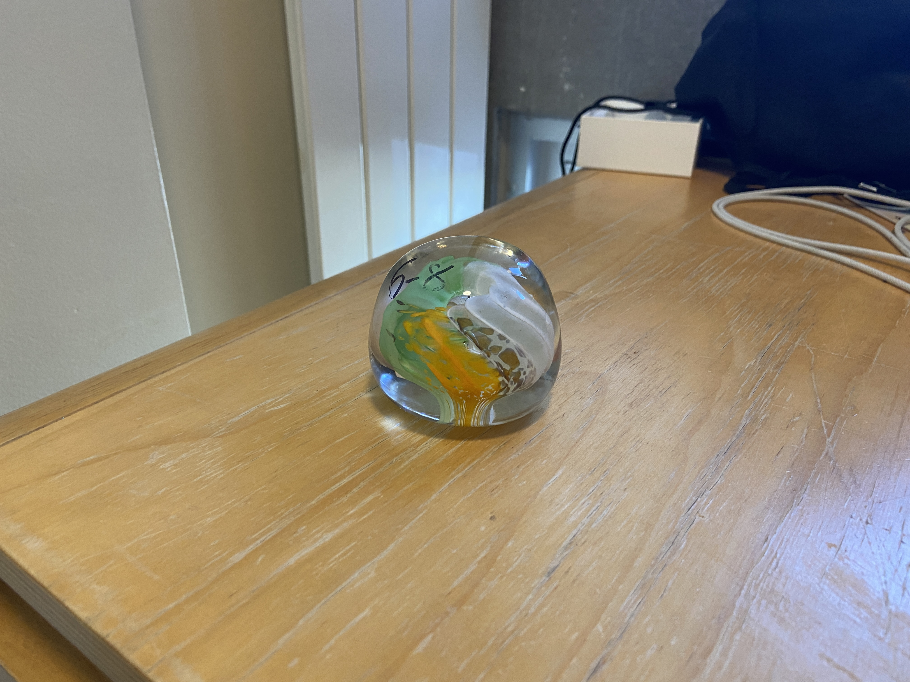
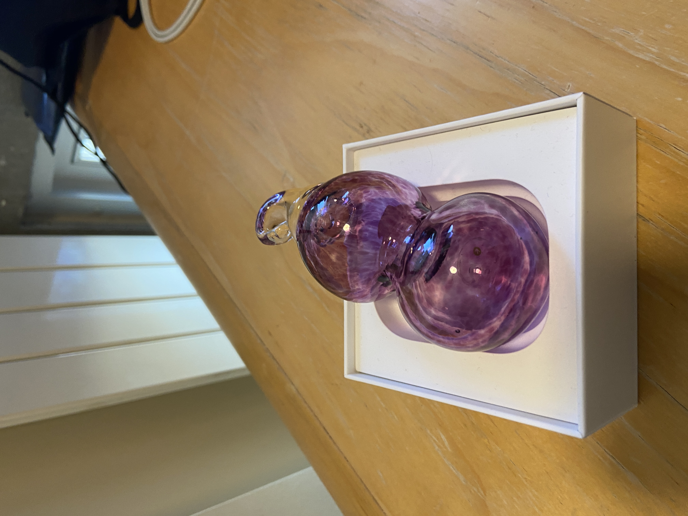
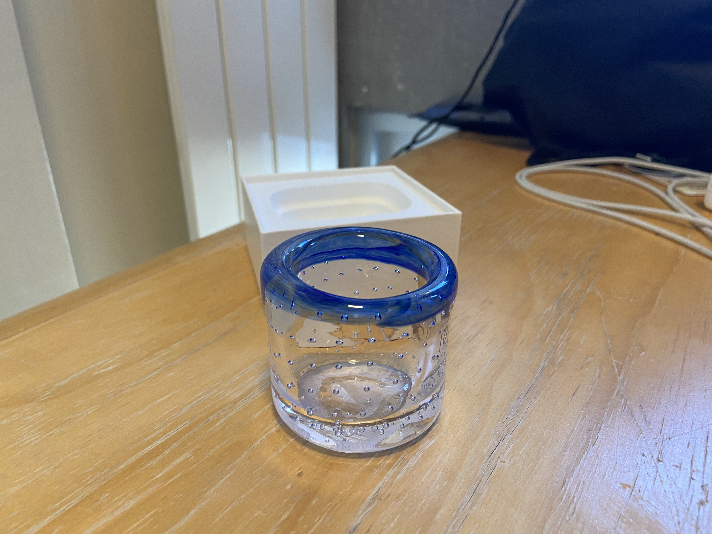
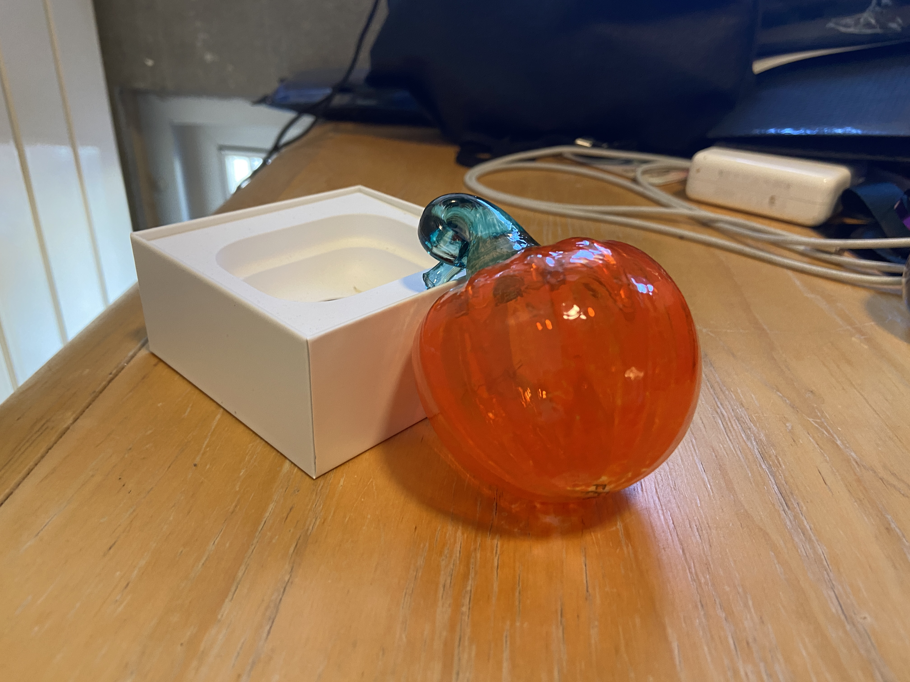
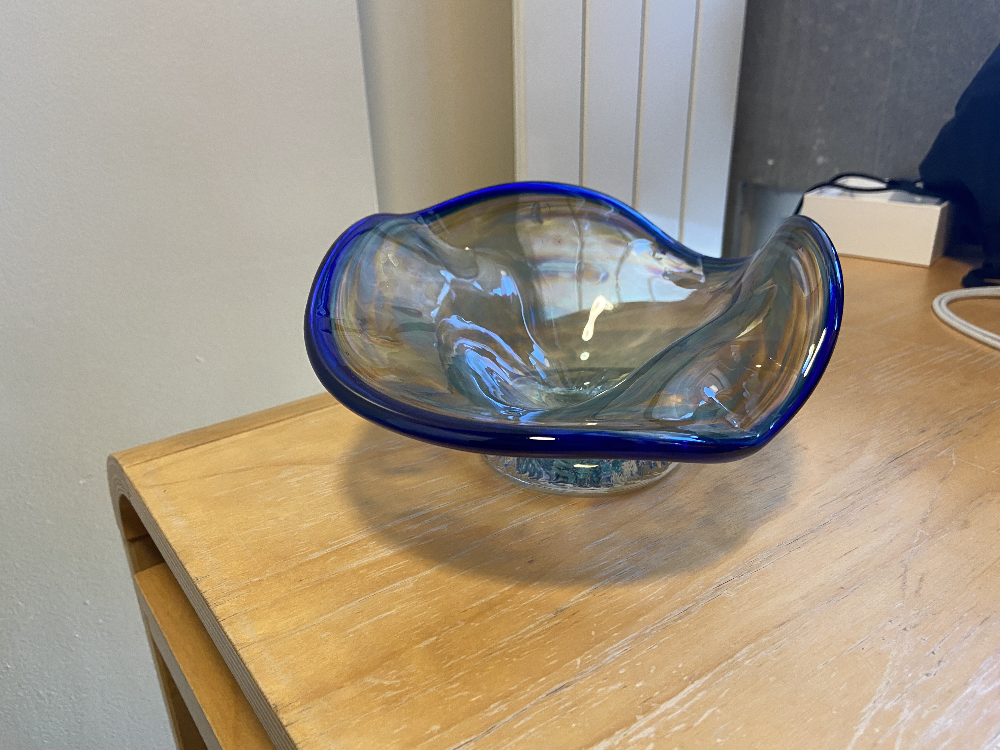

I'm lucky to be part of the MIT glassblowing lab, where I get to make all sorts of cool things **out of glass!** I've taken the beginner class twice (Fall 2022 and Fall 2023) and the intermediate class once (Spring 2024).

The last week of the beginner class is always a project week where you can make anything you want. I made a turtle.

## Other glass pieces

Here are some of my favorite other things from the glass lab.

*A paperweight in the Irish flag colors*

*An ornament*

*A cup circled with bubbles, with a blue lip wrap*

*My basic attempt at a glass pumpkin*

*A ruffle bowl with a blue lip wrap*
