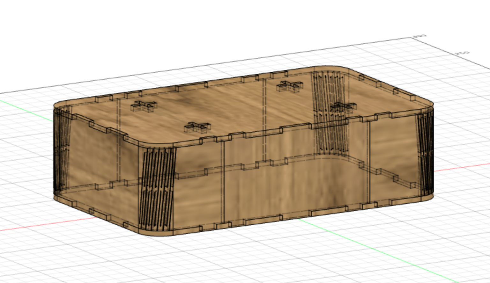
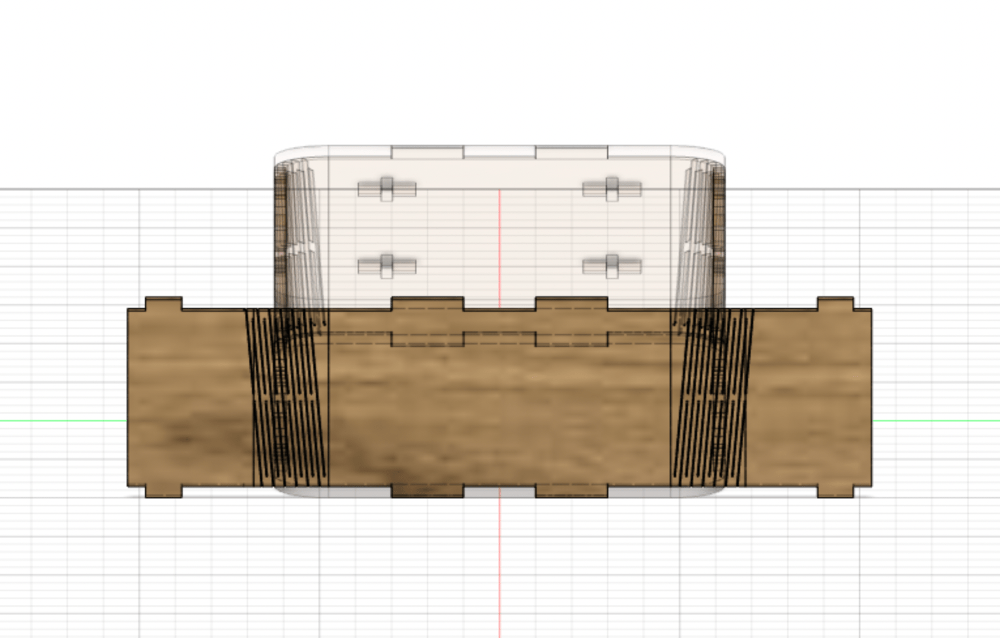
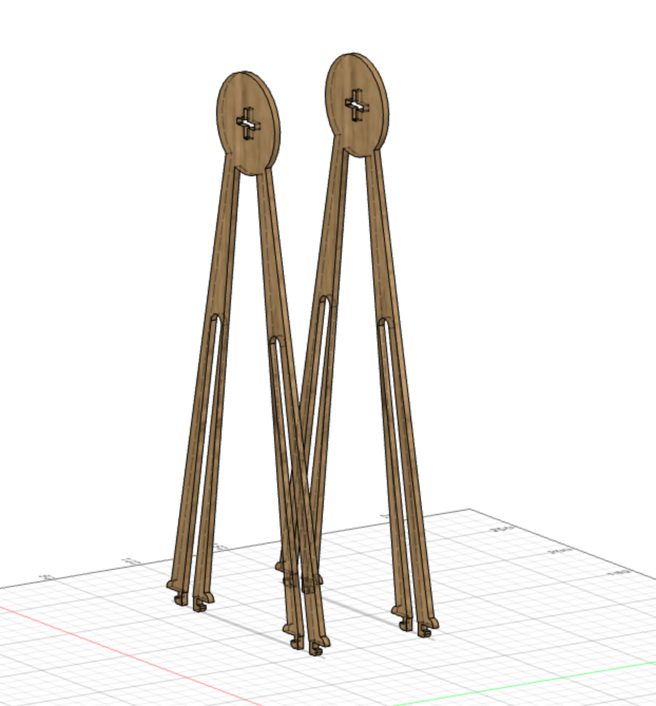
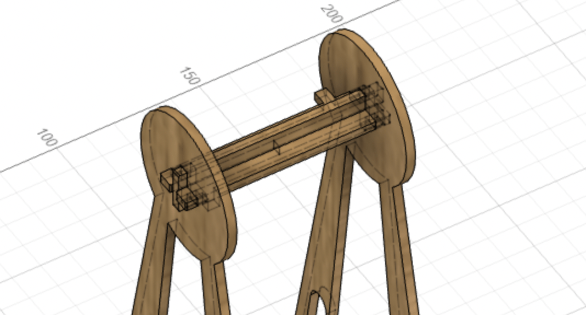
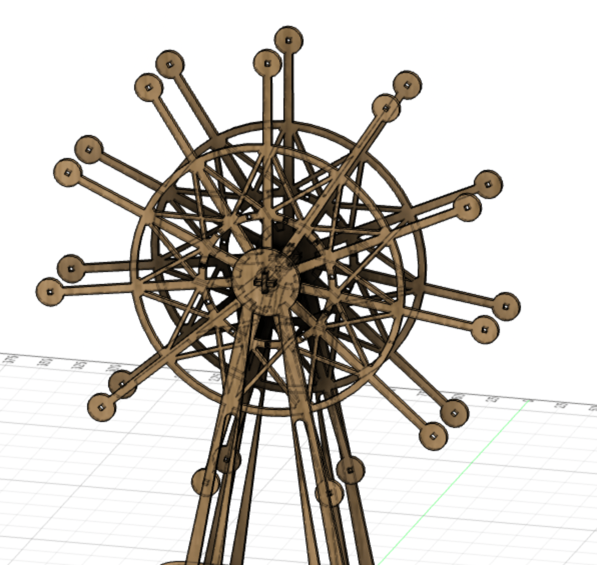
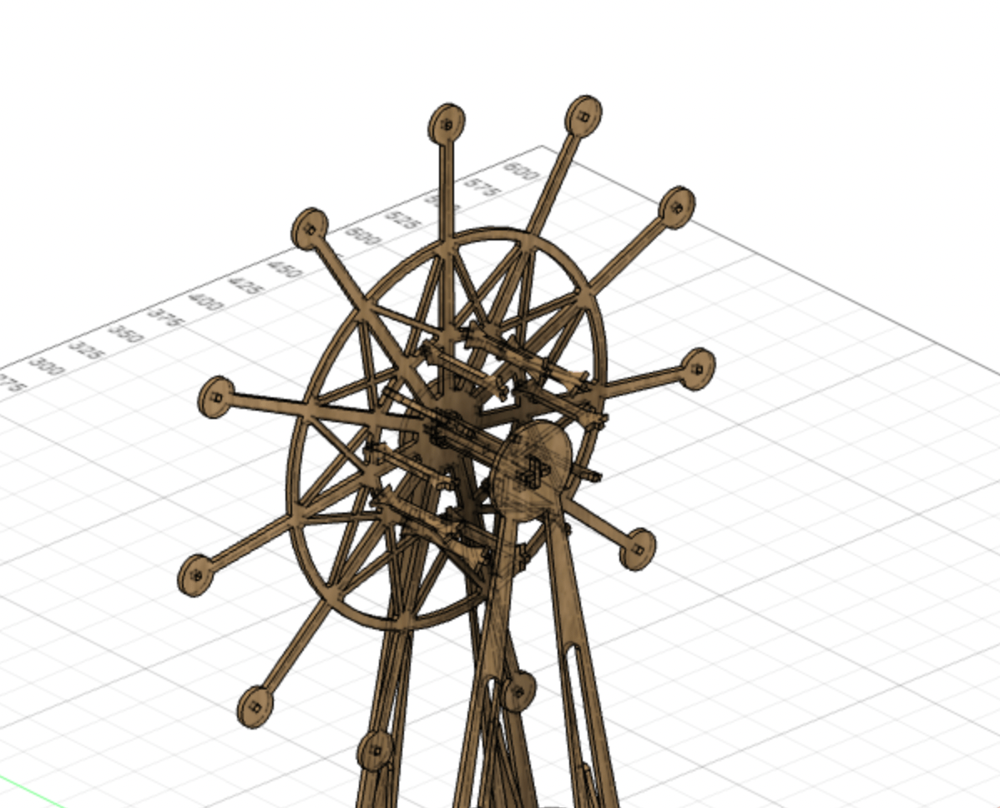
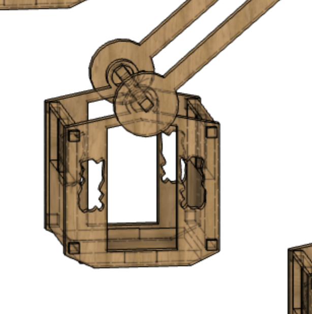
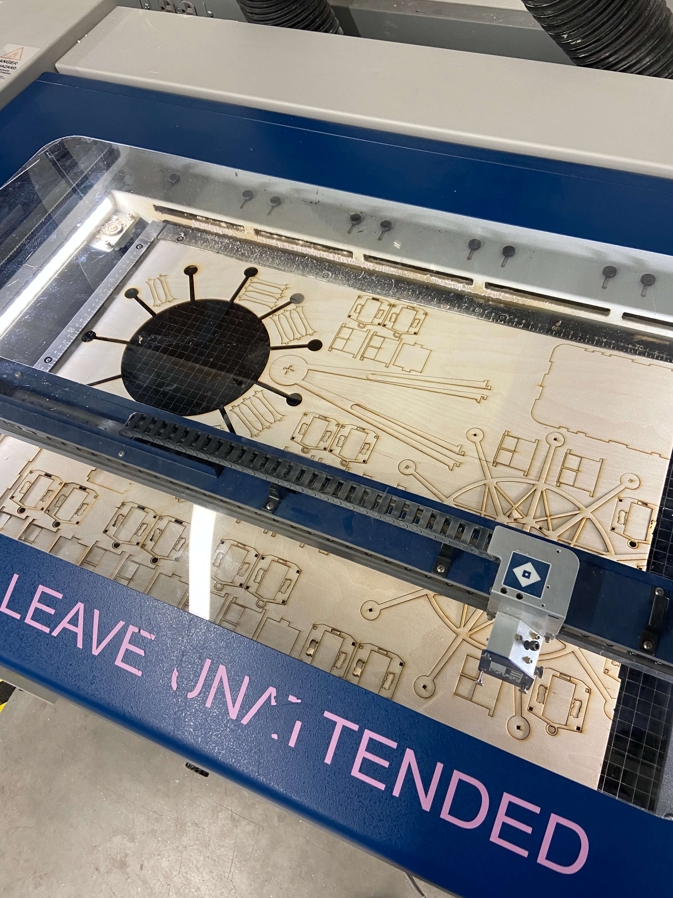
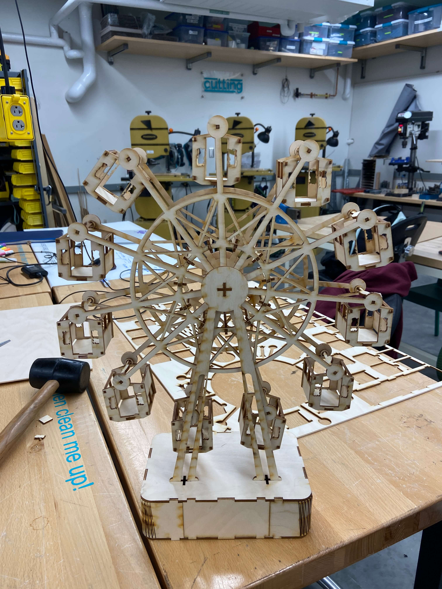

## The base

I wanted the base to be a pill shape with rounded edges. To achieve this I decided to use [living hinges](https://en.wikipedia.org/wiki/Living_hinge). This technique allows you to form a large radii from a single rigid material by repeating pattern of cut-out slots.

I used Fusion 360's Sheet Metal tool to see how the sides would bend

*Extruded sheet metal base*

This tool had the advantage of then being able to unfold the pieces for laser cutting:

*Unfolded side of the base*

## The wheel

For the wheel, each part was drawn in a sketch and then extruded. I used Fusion's **Joint** tool to ensure everything fitted together.

There are two supporting beams whose joints fit under the top of the base

*Ferris wheel supports*

To connect the two beams there is a support bar composed of two pieces which fit together

*Ferris wheel support bar*

Next up was actual wheel

*Ferris wheel wheel*

The two wheels are joined by pressfit support bars

*Ferris wheel wheel joint bars*

Finally, there was the cart:

*Ferris wheel cart*

## Laser cutting & assembly

To ensure that the fit-press joints worked I needed to account for kerf - the width of material that is lost during the laser cutting process.

After doing this, I exported all the pieces as DXFs, made some test cuts, then cut everything out.

*Laser cutting the parts*

*Assembled Ferris wheel*

