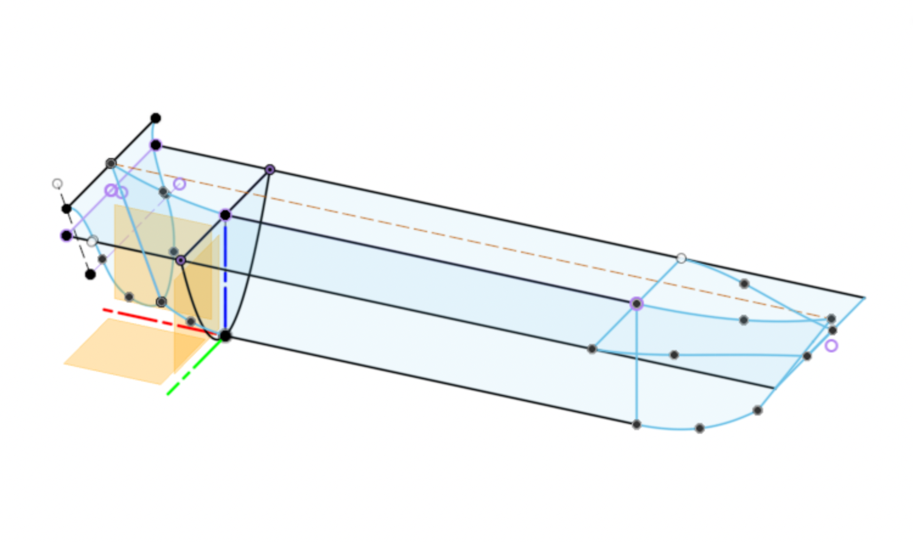
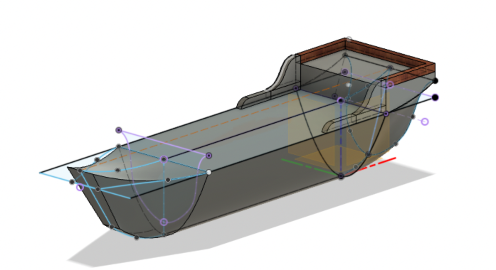
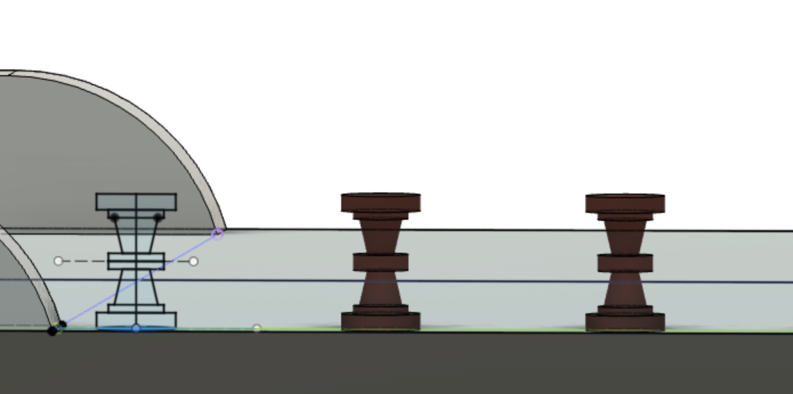
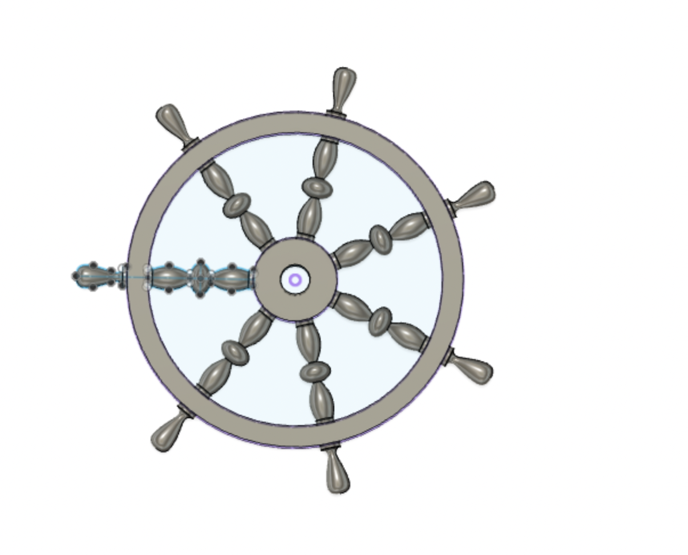
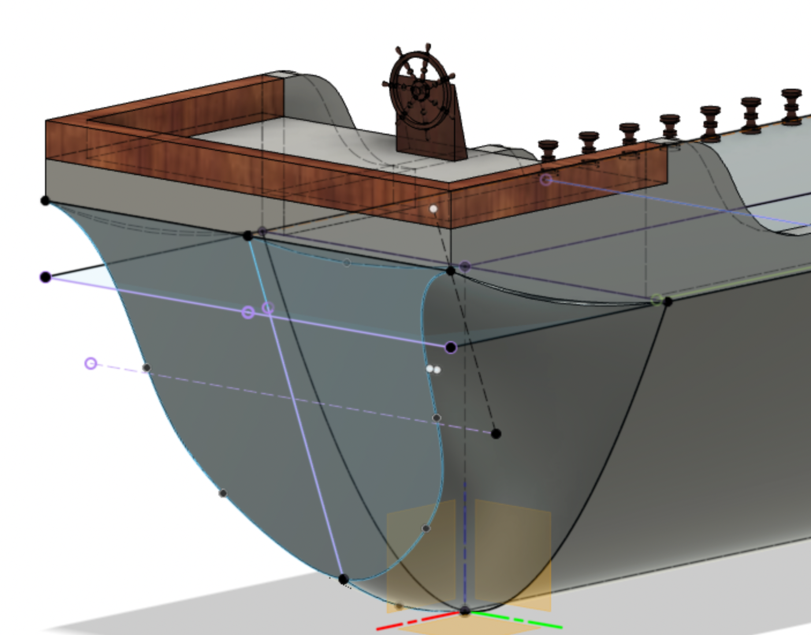
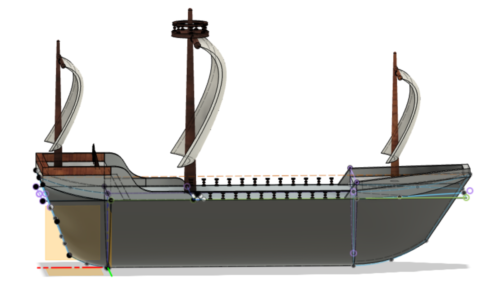
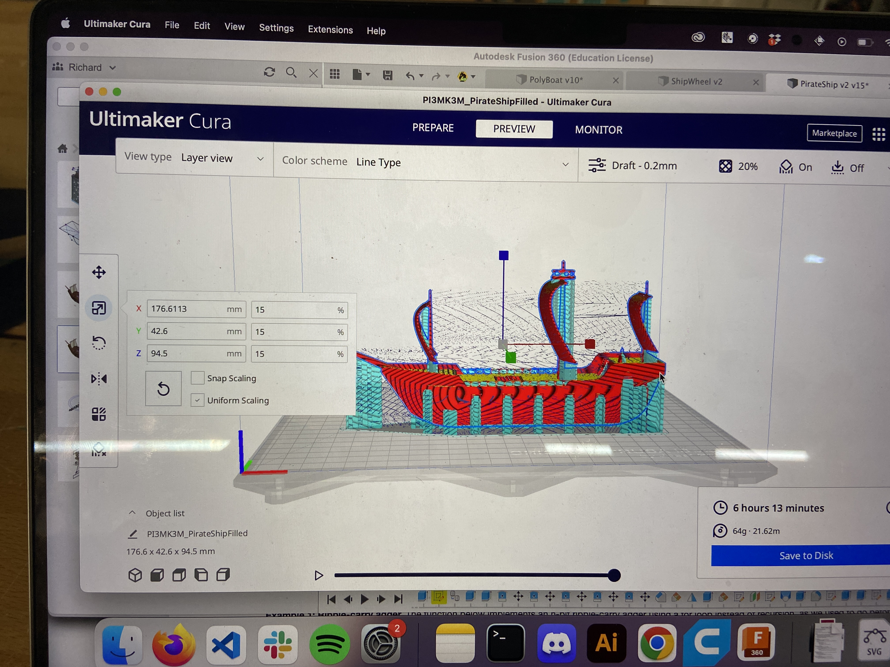
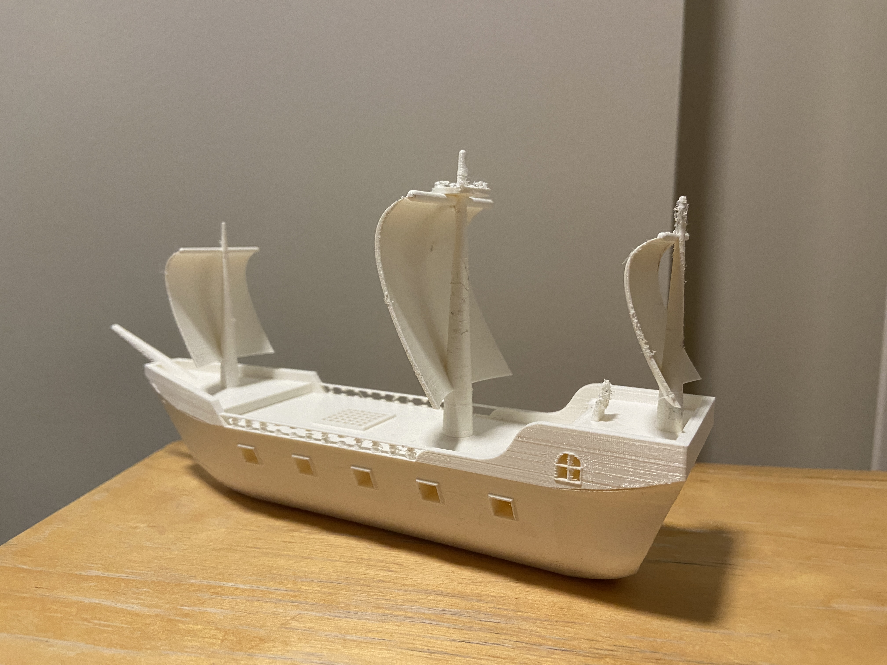
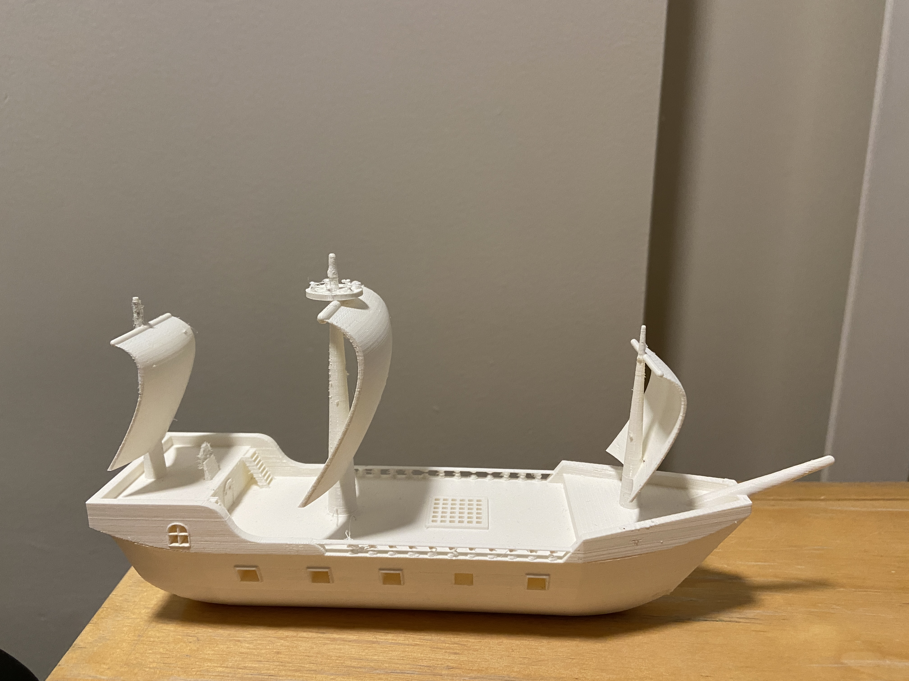

import PirateShipViewer from "./PirateShipViewer";

For my week 4 assignment for How to Make Almost Anything (HTMAA) (6.9020), I designed and printed a pirate ship. I wanted to improve my Fusion 360 skills and try out the soluble supports on the Ultimaker S5.

## Designing the pirate ship

I started by sketching the profiles of the hull. I added a spline at the top and bottom of the end piece to use as rails while lofting, which gives the ship its distinctive curved end.

*Sketch of ship hull*

I extruded and cut a rectangular section into the front of the boat for the captain's quarters.

*Adding captain's quarters*

Then came the posts along the sides of the boat.

*Sketching and revolving ship wall posts*

In a separate file, I designed a ship's wheel and linked it into the ship.

*Ship's wheel*

*Wheel on the ship*

After more adventures in lofting, I added the masts and sails. To mimic wind in the sails, I drew splines in a 3D sketch and used them as rails when lofting between the curved top and bottom of each sail.

*Sails on the ship*

<PirateShipViewer client:only="react" />

## 3D printing

One of the makerspaces at MIT has an Ultimaker S5, a dual-extruder printer that uses PVA for water-soluble supports. The deck might have printed without supports by bridging, but the sails definitely needed them, so the plan was to print with PVA and dissolve the supports away.

*Slicing pirate ship in Cura*

I forgot to take a picture of it with all the supports, but there were a ton. It took 5 days in a bath of water for everything to dissolve. Once it was in the water, I also realised it doesn't actually work as a boat: it sinks. I'm not too disappointed, since I didn't design it to float, but I'd love to try making a boat that does.

*Side view of finished pirate ship*

*Back view of finished pirate ship*

